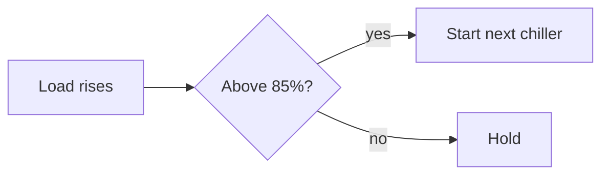

# Chiller Plant Optimisation
Practical steps for facility engineers

### Plant room at a glance
- Three 500 kW centrifugal chillers
- Primary-secondary pumping
- Cooling towers on the roof

### One number to remember
- **0.6 kW/TR**: the plant efficiency we are aiming for

### Sequencing logic

- Stage chillers on load, not time
- Keep each machine near its best point

### Efficiency improves month by month
<!-- chart: line -->
| Month | kW/TR |
|:---|---:|
| Jan | 0.92 |
| Feb | 0.88 |
| Mar | 0.81 |
| Apr | 0.74 |
| May | 0.69 |

### Measures ranked by payback
<!-- chart: hbar -->
| Measure | Payback (months) |
|:---|---:|
| Setpoint reset | 2 |
| Chiller sequencing | 5 |
| VSD on pumps | 14 |
| Tower fan VSD | 18 |

### What the operators must do
1. Check the condenser water temperature at every shift change
2. Log the chiller load and kW in the BMS each hour
3. Report any chiller running below 40% load for more than an hour
4. Clean the condenser tubes every six months

### Ready to start
Good controls beat new chillers.
